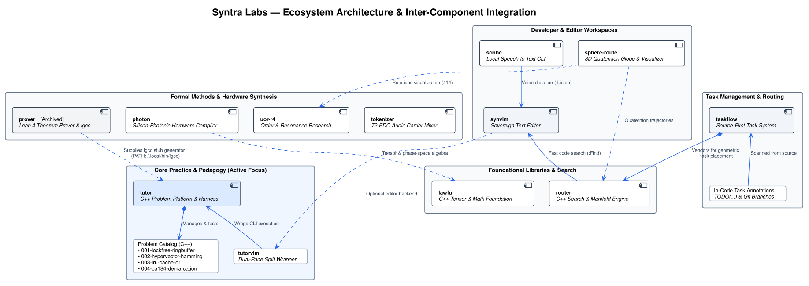

# Syntra Labs

**Interactive Coding Tutors, Distributed Systems Practice, and Developer Tools**

*Helping programmers build deep understanding rather than relying on auto-generated code.*

---

## Overview

**Syntra Labs** builds open-source tools for developers who want to master systems programming, distributed systems, and software verification.

Instead of writing code for you, our tools are built to help you practice and understand hard engineering problems: distributed consensus, lock-free concurrency, memory management, and performance tuning.

---

All project milestones, ideas, and problem definitions are tracked in our **[GitHub Issues Tracker](https://github.com/Syntra-Labs/.github/issues)**.

---

## Architecture & Ecosystem Integration

The following architectural diagram models the end-to-end component layout and data flow across the **Syntra Labs** ecosystem:

> Source PlantUML: [`docs/architecture/syntra_ecosystem.puml`](docs/architecture/syntra_ecosystem.puml) | Generated using [`docs/architecture/generate_diagrams.sh`](docs/architecture/generate_diagrams.sh)

---

## Contributing

We welcome systems programmers, researchers, and developers who care about building tools that help people learn and build better software.

- Check out our roadmap in [GitHub Issues](https://github.com/Syntra-Labs/.github/issues).
- Browse our repositories under the [Syntra-Labs Organization](https://github.com/Syntra-Labs).
