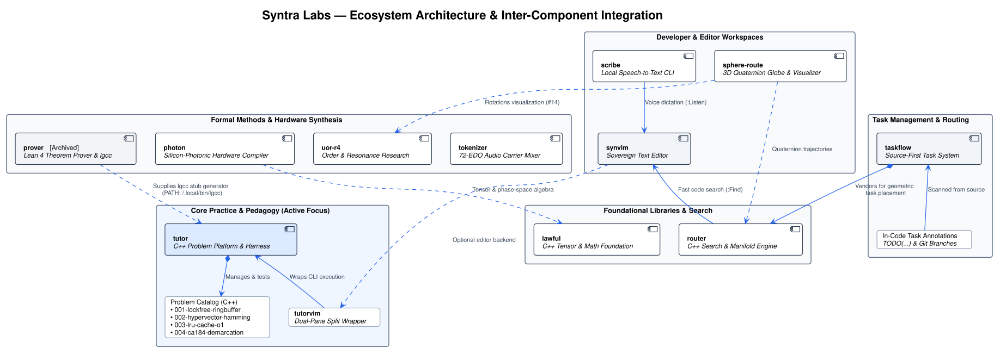

Mostly theoretical or archived works... take a look at [syntra-tutor](https://github.com/Syntra-Tutor), which branched out to focus on more practical applications.

> Source PlantUML: [`docs/architecture/syntra_ecosystem.puml`](docs/architecture/syntra_ecosystem.puml)
>
> Generated using [`docs/architecture/generate_diagrams.sh`](docs/architecture/generate_diagrams.sh)

---
